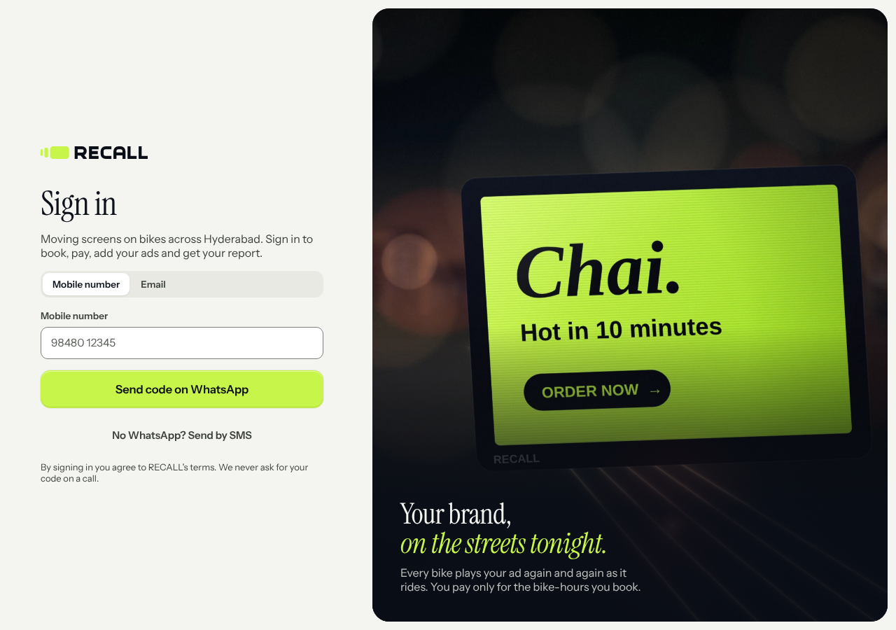
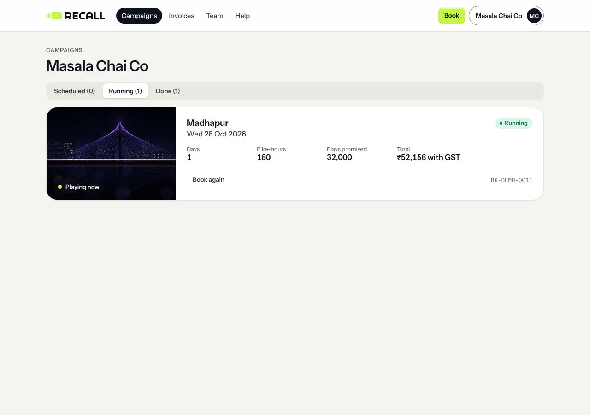
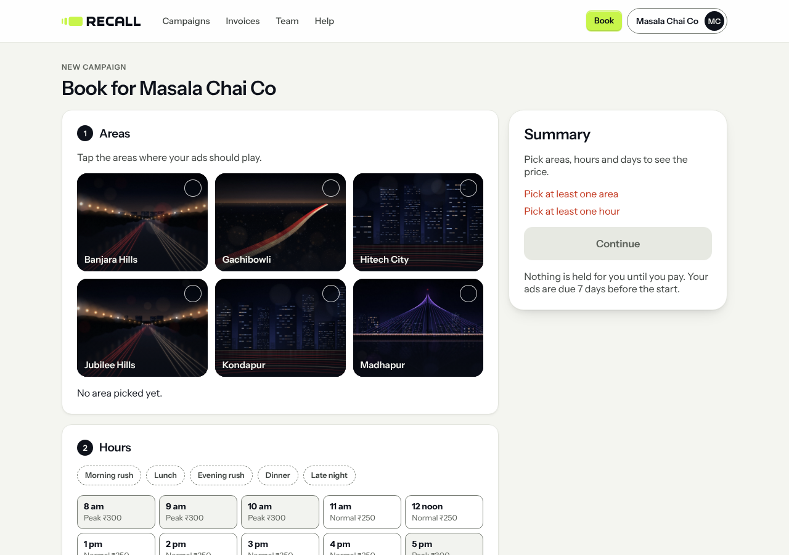
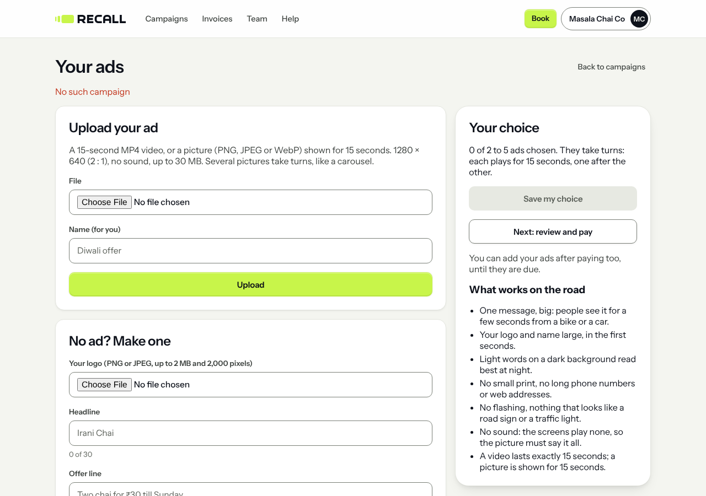
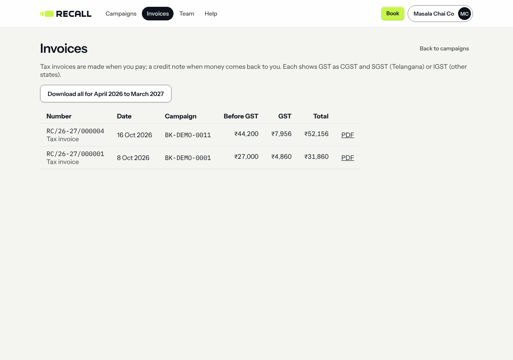
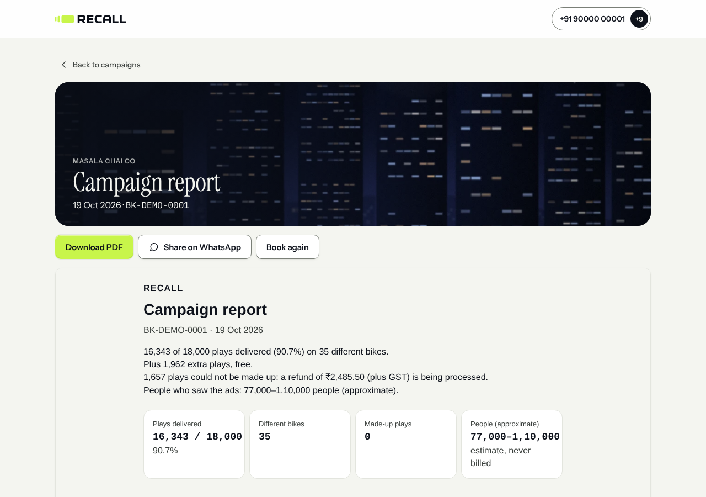
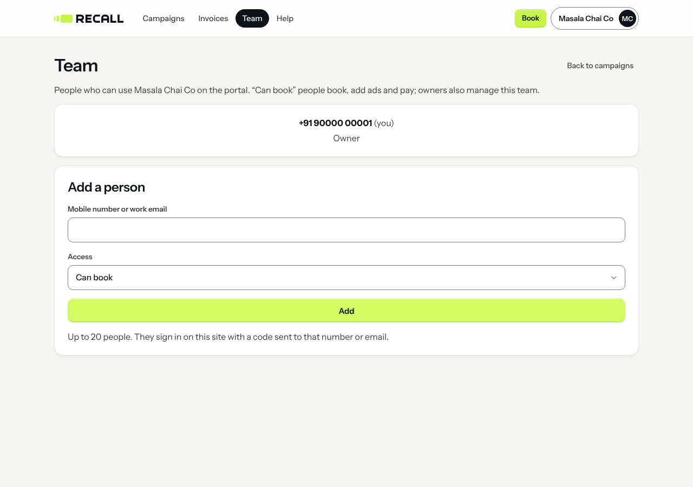
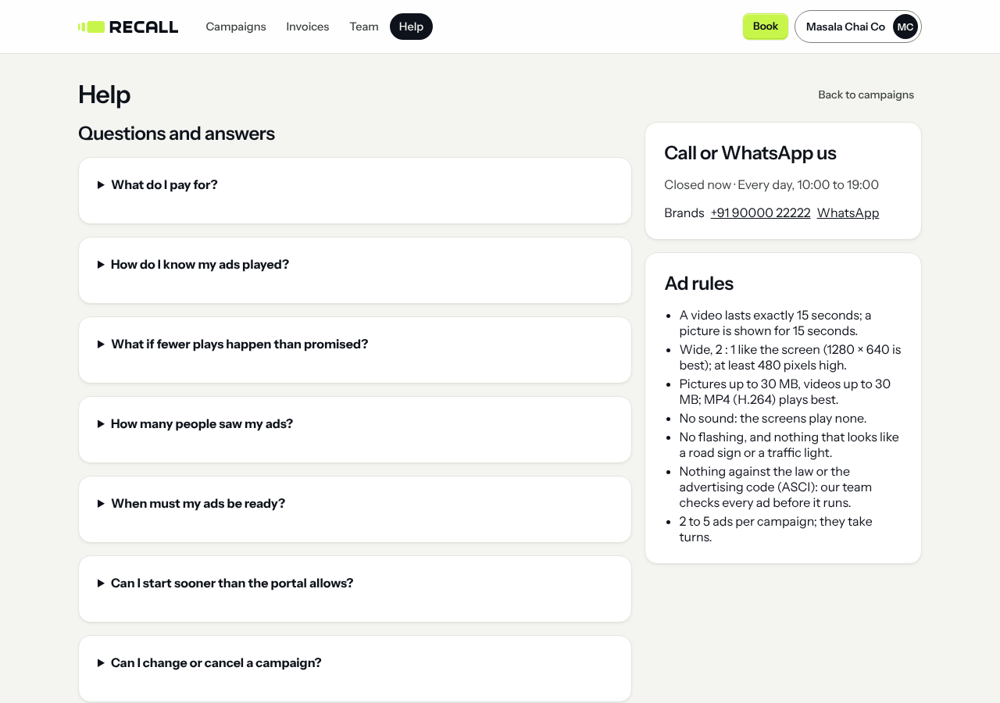
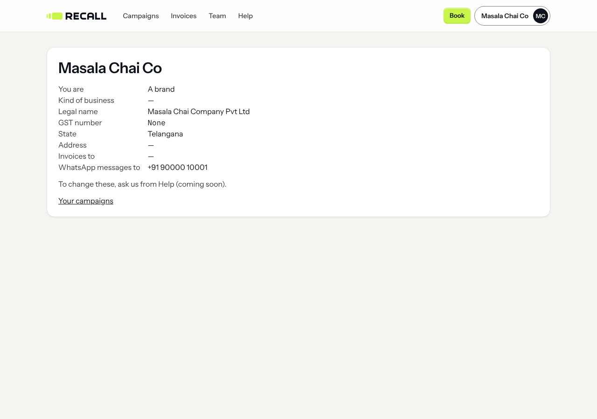

# Brand portal: a guide

The brand portal is where businesses do everything themselves:
- book screens by area and hour;
- pay;
- add their ads;
- get their invoices and reports.

In the demo, open it from the **demo desk** → **Open the brand portal**.

← [Back to the demo guide](../DEMO.md) · [Staff portal](STAFF_PORTAL.md) · [Rider app](RIDER_APP.md)

---

## Signing in

1. **Mobile number:** `9000000001`. This is the owner of *Masala Chai Co*, a made-up tea shop.
2. Click **Send code on WhatsApp**.
3. The 6-digit code appears on the **demo desk** within a few seconds. In real life it comes by WhatsApp. Type it in **Code**.
4. Click **Sign in**.

There's no password to forget. An agency can also sign in, using the email `media@adwise.demo`. It manages two brands from one login.

## The pages

### Campaigns (home)

The brand's campaigns, in three tabs: **Scheduled**, **Running** and **Done**. Each card shows:
- the dates and areas;
- the bike-hours bought;
- the plays promised;
- the total with GST.

The buttons:
- **Book again** copies the campaign into a new booking.
- The bar at the top has **Campaigns**, **Invoices**, **Team** and **Help**, the volt **Book** button, and the business's name. Click the name for **Business details**, switching to another business, and **Sign out**.

### Book

Booking takes three steps:
1. **Areas:** tap the parts of the city on the map.
2. **Hours:** tap single hours, or a ready-made group such as *Morning rush* or *Dinner*. Each hour shows its price per bike-hour.
3. **Days and bikes:** choose the dates and how many bikes.

The **Summary** on the right shows the price as you choose. Then click **Continue** to see the full price with GST, and pay.

In the demo, payment goes to a stand-in page with one **Pay** button. No money moves.

Nothing is held for the brand until it pays. Ads are due 7 days before the start.

### Your ads

Ads can be added in two ways:
- **Upload your ad:** a 15-second video, or a picture shown for 15 seconds.
- **No ad? Make one:** upload a logo, type a headline and an offer, and RECALL makes the ad. This is useful for small shops with no designer.

Choose 2 to 5 ads. They take turns on the screen.

The right side lists **What works on the road**: big words, no small print, nothing that looks like a road sign. Each ad is checked by RECALL staff before it plays.

### Invoices

A GST tax invoice is made the moment the brand pays. A credit note is made when money comes back as a refund. The buttons:
- **PDF** downloads one invoice;
- **Download all** downloads the whole financial year, for the accountant.

### Campaign report

Open it from a finished campaign. It shows:
- plays delivered out of plays promised;
- how many different bikes played the ads;
- plays made up, and any refund;
- a rough count of people who saw the ads. This is an estimate and is never billed;
- a map of where the ads played.

The buttons are **Download PDF**, **Share on WhatsApp** and **Book again**.

### Team, Help, Business details

- **Team:** add colleagues who can book, or who can only view.
- **Help:** common questions, plus WhatsApp and phone support.
- **Business details:** the legal name and GSTIN that appear on invoices.

---

## 5-minute demo script (for investors)

Before the call, sign in as Masala Chai Co.

| Time | Click | Say |
|---|---|---|
| 0:00 | **Campaigns** | "A café owner signs in with their phone number. No salesperson is needed. They can see a campaign running right now." |
| 0:45 | **Book** → tap *Madhapur* and *Hitech City* → tap **Evening rush** → pick a day | "They pick the parts of the city and the hours that matter to them. The price is per bike-hour and shown up front." |
| 1:45 | **Continue** → **Pay** on the stand-in page | "They pay online with UPI or a card. A GST invoice is made instantly." |
| 2:30 | **Your ads** → **No ad? Make one** | "A small shop has no designer. It types a headline and an offer, and we make the ad." |
| 3:15 | **Back to campaigns** → **Done** → open the report | "After the campaign, they get proof: plays delivered, on how many bikes, and where. If we fell short, the refund is already on its way." |
| 4:15 | **Invoices** | "Every invoice and credit note in one place, ready for their accountant." |
| 4:45 | **Book again** | "Booking the next campaign takes one click. That repeat business is what we're after." |
