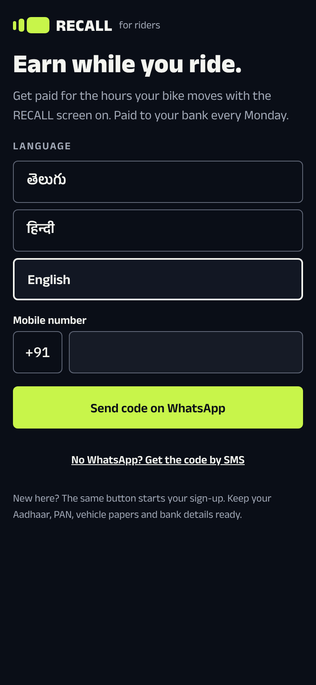
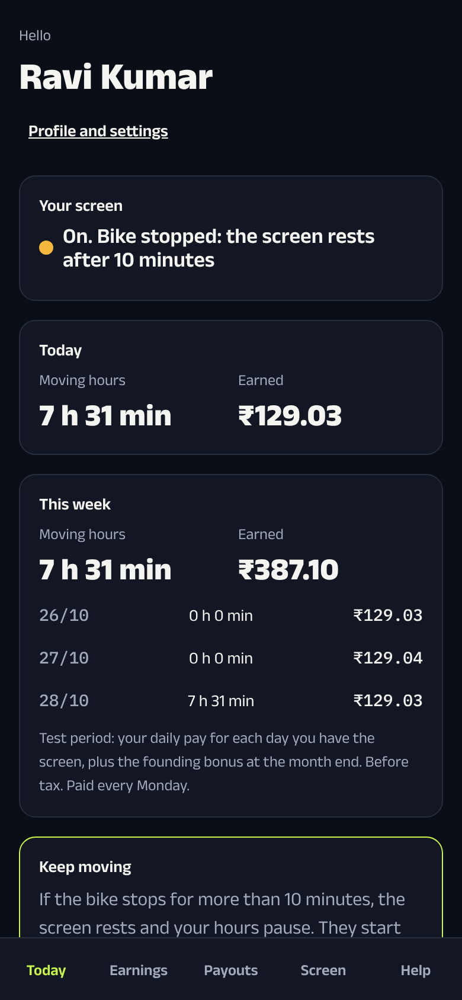

# Rider app: a guide

The rider app is the phone app for the people who ride with a RECALL screen. With it they:
- join;
- see what they earn;
- get paid every Monday;
- look after the screen;
- ask for help.

In the demo it runs in the browser, in phone size. Open it from the **demo desk** → **Open the rider app**.

**Tip:** to make it look like a phone on a big screen, press F12 in Chrome, then click the phone icon.

← [Back to the demo guide](../DEMO.md) · [Staff portal](STAFF_PORTAL.md) · [Brand portal](BRAND_PORTAL.md)

---

## Signing in

1. **Mobile number:** `9848000000`. This is Ravi Kumar, a made-up rider.
2. Click **Send code on WhatsApp**.
3. The code appears on the **demo desk**. Type it in **Code**, then click **Sign in**.

The app works in English, Telugu and Hindi. To switch, go to **Profile and settings**.

## The tabs

The tabs run along the bottom.

### Today

- **Your screen:** whether the screen is on, and whether the bike is moving or stopped. After 10 minutes stopped, the screen rests.
- **Today and This week:** moving hours and money earned.
- **Keep moving:** a reminder that hours pause when the bike stops for a long time.

### Earnings
Each month, with the newest first. It shows:
- what the rider earned and what it came from: moving hours, the base pay during the test period, their share of sales and bonuses;
- a breakdown by week and by day;
- a monthly statement they can save.

### Payouts
- When the next payment comes (every Monday) and about how much it will be.
- Which bank account or UPI ID it goes to.
- Every past payment and whether it arrived.
- The tax held back each quarter.

### Screen
- How to charge the screen and look after it.
- **Report a problem**, with a photo. The problems are:
  - not turning on;
  - damage;
  - theft;
  - an accident.

  Theft and accidents reach support at once, marked urgent.
- **Screen loan:** the screen is the rider's own, bought with a bank loan. This shows the EMI, the next due date and the bonus that goes toward it.

### Help
- Common questions.
- WhatsApp chat or a call to support, with support's hours.
- Writing to support from the app, and seeing where each request stands.

### Profile and settings
- Name, photo and papers. A renewed RC or insurance can be sent from here.
- Language.
- Where pay goes.
- Leaving RECALL.

## Joining (a new rider)

A new number sees **Earn while you ride** and six steps:
1. **Profile:** name, photo, where they ride, and the apps they ride for (such as delivery or bike-taxi apps).
2. **Vehicle papers:** number plate, RC and insurance photos.
3. **ID check:** Aadhaar through DigiLocker, and PAN.
4. **Bank or UPI:** RECALL sends ₹1 to check the account is theirs.
5. **Agreement:** read it and sign on the phone with Aadhaar.
6. **Screen loan.**

After that, staff approve the rider and book a fitting. To show this in the demo, sign in with any new 10-digit number, such as `9811112222`.

---

## 5-minute demo script (for investors)

| Time | Show | Say |
|---|---|---|
| 0:00 | Welcome page | "Our riders already ride for delivery and bike-taxi apps. They join from their phone in about 10 minutes." |
| 0:45 | Sign in as Ravi → **Today** | "Ravi sees whether his screen is on and what he has earned today. It updates as he rides." |
| 1:45 | **Earnings** | "He's paid for hours moving, plus a share of what brands pay. Extra income with no extra work." |
| 2:45 | **Payouts** | "Paid every Monday, straight to his bank. Tax is handled for him." |
| 3:30 | **Screen** | "If the screen is damaged or stolen, he reports it with a photo and support is alerted at once." |
| 4:15 | Sign out → new number → the six joining steps | "ID, bank and the agreement are all checked digitally. No paper, and no office visit except the fitting." |
